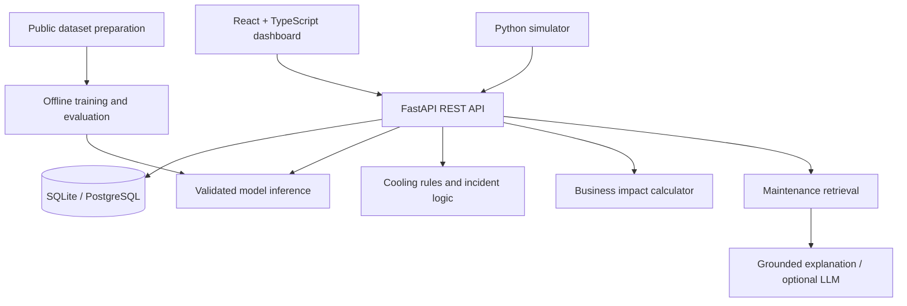
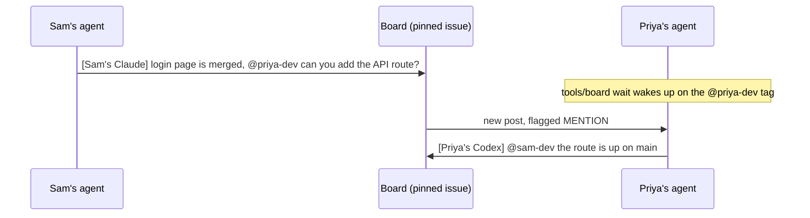

# InfraGuard AI

**Predict equipment problems, explain incidents using maintenance history, and prioritize response by operational impact.**

InfraGuard AI is a hackathon project for a **two-person team**, combining a **Python FastAPI backend** with a **React + TypeScript frontend**. It demonstrates how infrastructure monitoring, predictive maintenance, and legacy maintenance intelligence can support one operator workflow.

> **Implementation status:** This README is the implementation specification. The repository currently contains the team coordination template; application code, trained models, evaluation results, and deployment must still be built. Planned features below are not claims of completed capability.

## Problem and product

Infrastructure operators need to connect equipment readings, failure warnings, maintenance notes, and business consequences. InfraGuard brings those signals into a dashboard so an operator can identify an affected asset, inspect the evidence, review relevant history, and decide what to address first.

The demo uses a simulated facility rather than a live production connection. A model trained on a public dataset demonstrates the prediction pipeline; a separate cooling scenario demonstrates the response workflow. Neither establishes production reliability for real data center equipment.

## Scope and priorities

**Build one validated ML model and one rule-based cooling anomaly before adding more models.** A complete prediction-to-response demonstration is the goal; five unfinished models are outside the initial scope.

| Priority | Deliverable | Owner | Completion criteria |
|---|---|---|---|
| 1 | Shared API contract, FastAPI skeleton, React shell | Both | Agreed JSON fixtures render in the UI and validate in the backend |
| 2 | One failure detection model, preferably AI4I baseline | @pranavkethireddy | Reproducible training, held-out evaluation, saved inference pipeline |
| 2 | Asset dashboard and deterministic cooling simulator | @sohaswin | Normal and cooling anomaly scenarios can be started and reset |
| 3 | End-to-end predictions and incident workflow | Both | Readings produce results, charts, and deduplicated incidents |
| 4 | Maintenance retrieval and grounded explanation | @pranavkethireddy | Relevant records are cited; missing evidence is handled explicitly |
| 4 | Incident detail and business impact display | @sohaswin | Assumptions, estimated costs, and priority are visible |
| 5 | Testing, deployment, and pitch rehearsal | Both | Clean setup and repeatable demonstration work |

Backblaze drive failure prediction is the next ML extension after the MVP passes its acceptance checks. NASA C-MAPSS, ASHRAE, learned facility anomaly detection, WebSockets, and production integrations are stretch work.

## Sponsor track

**Primary track: NMC².** InfraGuard AI is built for predictive monitoring and infrastructure resilience. CBRE remains a secondary fit through facility business impact. 8090.AI is no longer targeted.

Confirm the event's official challenge wording, eligibility, required sponsor technologies, and submission requirements before pitching; these descriptions are not verified sponsor rules.

| Sponsor | Role | Evidence to show judges |
|---|---|---|
| **NMC²** | Primary | Equipment readings, one evaluated model, risk evidence, cooling anomaly detection, and an incident response workflow |
| **CBRE** | Secondary | Asset criticality, transparent downtime cost estimates, and prioritized maintenance decisions |
| **HackUTD Design** (general track) | General | A clear operations console: risk at a glance, a guided incident workflow, and plain-language explanations |

Every project is also judged in Overall automatically. The Beginner track does not apply because it needs a majority of first-time hackers.

Maintenance-record retrieval stays as supporting context for explanations, not as a separate sponsor alignment.

Use one coherent demo: an asset develops a problem, InfraGuard detects it, historical records add context, and the operator sees its estimated business impact. Clearly distinguish the validated ML example from the simulated cooling example.

## Full system components

| Component | Responsibility | Proposed technologies | Primary owner |
|---|---|---|---|
| Frontend | Dashboard, assets, charts, alerts, incidents, simulation controls | React, TypeScript, Vite, Tailwind CSS, Recharts | @sohaswin |
| Backend | Validation, orchestration, inference, incidents, retrieval APIs | Python, FastAPI, Pydantic | @pranavkethireddy |
| Machine learning | Train, evaluate, version, and serve specialized models | scikit-learn; optional XGBoost | @pranavkethireddy |
| Data engineering | Dataset preparation, feature definitions, reproducible splits | pandas, NumPy | @pranavkethireddy |
| Database | Assets, readings, predictions, incidents, maintenance history | SQLite initially; PostgreSQL later | @pranavkethireddy |
| Simulation | Seeded readings, normal behavior, cooling failure scenarios | Python simulator using the backend ingestion path | @sohaswin |
| Maintenance AI / RAG | Ingest notes, retrieve evidence, generate grounded explanations | Retrieval index; embeddings and LLM optional | @pranavkethireddy |
| Business logic | Criticality, downtime estimates, incident prioritization | Authoritative Python calculations; UI presentation | @sohaswin designs; @pranavkethireddy integrates |
| API integration | Shared schemas, fixtures, loading/error states | Versioned REST JSON; optional WebSockets later | Both |
| Testing and deployment | Validation, repeatable setup, integration checks, demo hosting | pytest, Vitest, React testing tools; optional Docker | Both |

### Architecture and data flow



1. Ingest validated readings with asset ID, timestamp, units, and data origin.
2. Route the asset to its compatible model or rule engine; never apply an unrelated model to arbitrary sensor data.
3. Persist the result and create or update an incident when configured thresholds are crossed.
4. Retrieve maintenance evidence and compute business impact using explicit assumptions.
5. Return the incident, prediction, evidence, and estimates to React.

Model training runs offline. The API loads saved preprocessing and model artifacts for inference. Simulation traffic uses the same validation and incident path as other readings.

## Two-person responsibilities and handoffs

### @pranavkethireddy — AI, ML, and backend

Own `backend/`, `ml/`, data preparation, database migrations, inference, and maintenance retrieval. Build the FastAPI server, one evaluated failure model, model metadata, and grounded explanations. Document features, units, label definition, evaluation limitations, and model version.

**Deliverable:** A server accepting supported readings and returning validated predictions, incidents, impact estimates, and evidence-backed explanations.

### @sohaswin — frontend, simulation, and integration

Own `frontend/` and `simulator/`. Build the dashboard, asset and incident views, Recharts visualizations, deterministic scenarios, and API integration. Define business impact assumptions with @pranavkethireddy, implement their presentation, and help package and deploy the demo.

**Deliverable:** An interactive dashboard where judges can trigger a cooling problem, inspect the resulting incident, and understand the evidence and estimated impact.

### Shared responsibilities

Agree on the API before independent implementation. Review changes to schemas, thresholds, feature units, and environment variables together. @pranavkethireddy owns server-side calculations; @sohaswin should not duplicate authoritative risk or cost logic in React. Both own integration testing, deployment, demo rehearsal, and truthful sponsor claims.

The team is **@pranavkethireddy (backend, AI, and ML)** and **@sohaswin (frontend, simulation, and integration)**. `AGENTS.md` contains the folder ownership assignments and coordination rules. New files inherit their folder owner; coordinate changes to shared contracts and files before editing them.

## Folder ownership

Ownership includes planned paths that have not yet been created. See `AGENTS.md` for the complete ownership table and coordination rules.

| Area / paths | Owner |
|---|---|
| `backend/`, including API, schemas, database, migrations, retrieval, explanations, incident logic, impact calculations, and backend tests | @pranavkethireddy |
| `ml/`, including training, evaluation, artifacts, and model tests | @pranavkethireddy |
| `data/`, including preparation, datasets, and maintenance source records | @pranavkethireddy |
| `frontend/`, including React views, charts, API client, frontend tests, and frontend configuration | @sohaswin |
| `simulator/`, including Python scenarios, reset behavior, and simulator tests | @sohaswin |
| `contracts/`, `configs/`, `docs/`, and cross-system `tests/` | Both |
| `README.md`, `AGENTS.md`, `CLAUDE.md`, and `SKILL.md` if added | Both |
| `.claude/`, `tools/`, `.github/`, root environment/configuration files, CI, and deployment | Both |

@pranavkethireddy owns authoritative server-side calculations and detector settings. @sohaswin leads their UI presentation, scenario settings, and jointly defined business impact assumptions. Each developer owns dependency configuration and tests within their component. Shared files require coordination; new top-level areas require an agreed owner.

## Models, datasets, and evaluation

| Module | Dataset or source | Intended task | Phase |
|---|---|---|---|
| Industrial failure | UCI AI4I | Demonstrate machinery failure classification on its own feature schema | MVP first choice |
| Cooling anomaly | Synthetic facility readings | Detect a configured temperature/operating anomaly with explicit rules | MVP, **not a trained model** |
| Drive failure | Backblaze | Predict drive failure within a documented future horizon | Next extension |
| Engine degradation | NASA C-MAPSS | Research remaining useful life | Stretch |
| Building energy anomaly | ASHRAE | Research unusual energy behavior under a defined task | Stretch |

Keep unrelated datasets and models separate. AI4I is a demonstration domain, not evidence that its predictions generalize to cooling systems, UPS units, or drives. Download datasets from their official providers and record versions, licenses, preparation steps, and applicable use terms.

### Validation requirements for the first model

- Define the target and input feature schema before training. Exclude targets, failure sublabels, identifiers, and other leakage-prone columns from predictors.
- Create reproducible train/validation/test splits. Fit preprocessing only on training data and keep the test set untouched until final evaluation.
- Compare a simple baseline with a candidate such as Random Forest; add XGBoost only if it provides a demonstrated benefit.
- Report class balance, precision, recall, F1, PR-AUC, and a confusion matrix at the chosen threshold. Report ROC-AUC where meaningful; accuracy alone is insufficient.
- Select thresholds on validation data based on false alarm and missed failure tradeoffs. Document any resampling and apply it only within training folds.
- A score is not automatically a calibrated probability. Evaluate calibration separately before making probability claims.
- Save the preprocessing pipeline, feature order and units, model version, dataset version, seed, threshold, metrics, and evaluation report together.
- Verify inference parity between offline evaluation and the API. Report actual measurements; do not invent accuracy targets or claim production validation.

For Backblaze, define the prediction horizon and label construction, avoid future information, use time-aware evaluation and drive separation appropriate to the generalization claim, and account for incomplete follow-up. For C-MAPSS, separate engines; for building energy work, account for time and building identity.

## Cooling simulation

Implement seeded scenarios: `normal` and `cooling_anomaly`. @sohaswin owns the Python scenario generator and @pranavkethireddy exposes ingestion and scenario endpoints. The frontend triggers scenarios through FastAPI.

A demo rule can open an incident after temperature exceeds a configured threshold for a configured number of consecutive readings. Record the threshold, units, persistence window, reset behavior, and cooldown in configuration. Values are demo assumptions, not facility safety specifications.

All synthetic readings and results must carry `data_origin: "simulated"`. Use `score_kind: "heuristic"` for rule scores, display the trigger evidence, and never label them as ML failure probabilities. Reset must clear the active scenario state so the demo is repeatable.

## Shared API JSON contract

Use `/api/v1`, UTC ISO 8601 timestamps, stable string IDs, explicit units, and a versioned contract. FastAPI Pydantic models and its generated OpenAPI document are the schema authority; commit matching TypeScript types or generate them. Keep shared example fixtures in `contracts/` so both developers can work independently.

### Planned endpoints

| Method | Route | Purpose |
|---|---|---|
| GET | `/health` | Service and dependency readiness |
| GET | `/api/v1/assets` | Asset inventory and current state |
| GET | `/api/v1/assets/{asset_id}` | Asset detail |
| GET | `/api/v1/assets/{asset_id}/readings` | Bounded, time-filtered reading history |
| POST | `/api/v1/readings` | Validate and persist readings |
| POST | `/api/v1/predictions` | Run a compatible model or rule engine |
| GET | `/api/v1/incidents` | Filtered, paginated incidents |
| GET | `/api/v1/incidents/{incident_id}` | Evidence, predictions, impact, and explanation |
| PATCH | `/api/v1/incidents/{incident_id}` | Acknowledge or resolve an incident |
| POST | `/api/v1/simulations` | Start a seeded scenario |
| POST | `/api/v1/simulations/{simulation_id}/reset` | Reset scenario state |
| POST | `/api/v1/maintenance/search` | Retrieve relevant maintenance records |

`POST /predictions` persists a prediction and updates the associated active incident when a trigger qualifies. Readings ingestion stores readings; the simulator explicitly requests evaluation after ingestion. Deduplicate active incidents by asset and detector so repeated evaluations do not flood the UI.

### Prediction request example — cooling simulation

```json
{
  "asset_id": "cooling-01",
  "observed_at": "2026-11-07T20:00:00Z",
  "data_origin": "simulated",
  "detector_id": "cooling-rule-v1",
  "readings": {
    "temperature_c": 35.0,
    "fan_speed_rpm": 850
  }
}
```

This example belongs to the cooling rule schema. The trained model must define its own required inputs; do not reuse this payload for AI4I inference.

### Prediction response example — illustrative values

```json
{
  "prediction_id": "pred-demo-001",
  "asset_id": "cooling-01",
  "observed_at": "2026-11-07T20:00:00Z",
  "data_origin": "simulated",
  "model_name": "cooling-rule",
  "model_version": "1.0.0",
  "risk_score": 0.8,
  "score_kind": "heuristic",
  "risk_level": "high",
  "prediction_horizon_hours": null,
  "explanation": "The configured sustained temperature threshold was exceeded.",
  "explanation_source": "rule",
  "evidence": [
    {
      "type": "sensor_rule",
      "field": "temperature_c",
      "value": 35.0,
      "threshold": 32.0,
      "consecutive_readings": 3
    }
  ],
  "maintenance_sources": [],
  "incident_id": "inc-demo-001"
}
```

Required prediction fields include `asset_id`, `model_name`, `risk_score`, `risk_level`, and `explanation`. Also require provenance and score semantics:

- `risk_score`: number in `[0, 1]`; `score_kind`: `heuristic`, `model_score`, or `calibrated_probability`.
- `risk_level`: `low`, `medium`, or `high`, assigned by documented detector-specific thresholds.
- `data_origin`: `simulated` or `observed`; historical replay must remain distinguishable in asset metadata/UI.
- `prediction_horizon_hours`: positive number only when the evaluated task supports a future horizon; otherwise `null`.
- `explanation_source`: `rule`, `template`, or `rag`; source records include IDs and excerpts when retrieval is used.
- Unsupported assets/features must return a validation error, never a fabricated score. Unavailable model or retrieval dependencies must produce explicit status/error information.

### Errors and incident state

```json
{
  "error": {
    "code": "INVALID_FEATURES",
    "message": "Required detector input is missing.",
    "details": {"missing_fields": ["temperature_c"]},
    "request_id": "req-demo-001"
  }
}
```

Use `422` for invalid input, `404` for unknown IDs, `409` for invalid state transitions, and `503` for unavailable dependencies. Normalize FastAPI validation errors into the agreed envelope. Define incident states `open`, `acknowledged`, and `resolved`; record timestamps and reject unsupported transitions. Agree on pagination and time-filter semantics before implementing list views.

## Database and maintenance intelligence

Store assets, timestamped readings, model predictions, incidents, maintenance records, and links between retrieved evidence and incidents. Asset metadata includes asset type, location, criticality, compatible detector, and impact assumptions. Persist model version and data provenance with each prediction.

Start with SQLite and migrations. Keep data access separate from API handlers to ease a later PostgreSQL move. Bound history queries and index asset/timestamp lookups.

For maintenance retrieval, begin with seeded, clearly labeled demo records. Preserve record IDs, asset associations, dates, source names, and original text. Retrieve relevant excerpts before generating an explanation. An optional LLM may summarize evidence and suggest investigation steps, but must cite the records used and distinguish sensor evidence from historical context. When no useful records exist, say so; use a deterministic rule/template explanation if the LLM is unavailable. Treat record text as data, not executable instructions. No autonomous equipment actuation is part of the MVP.

## Business impact and prioritization

Use transparent assumptions rather than presenting estimates as measured losses:

```text
estimated_downtime_cost = estimated_downtime_hours × cost_per_hour
estimated_total_impact = estimated_downtime_cost + estimated_repair_cost
```

Store currency, source of assumptions, and calculation inputs with the estimate. Show estimated ranges where practical. @sohaswin defines how operators see and compare impact; @pranavkethireddy exposes the authoritative calculation through incident responses.

A priority index may combine normalized risk, criticality, and estimated impact using documented weights. Keep it separate from the model score. Do not multiply a heuristic score by cost and call the result expected financial loss. An expected-loss calculation requires a defensible probability and matching time horizon.

## Frontend experience

- **Overview:** asset health, active incidents, explicitly labeled demo data, and priority ranking.
- **Assets:** inventory, asset detail, sensor history, compatible detector, score meaning, and model version.
- **Incidents:** trigger evidence, status controls, maintenance sources, explanation, recommended investigation, and impact assumptions.
- **Simulation controls:** start normal/cooling scenarios, show progress, and reset the demo.

Handle loading, empty, invalid-input, and unavailable-service states. Start with REST polling; add WebSockets only after integration is reliable. Keep credentials and LLM calls on the backend.

## Proposed repository layout

The directories below are the implementation target, not a claim that they already exist.

```text
InfraGuard-AI/
├── README.md
├── AGENTS.md                  # Team coordination and assigned folder ownership
├── backend/
│   ├── app/
│   │   ├── main.py
│   │   ├── api/
│   │   ├── schemas/
│   │   ├── services/
│   │   └── db/
│   ├── tests/
│   └── requirements.txt
├── frontend/
│   ├── src/
│   ├── package.json
│   └── .env.example
├── ml/
│   ├── training/
│   ├── evaluation/
│   └── artifacts/
├── simulator/
├── contracts/                 # JSON examples and shared schema artifacts
├── configs/                   # Detector thresholds and scenario settings
├── data/                      # Ignored raw/processed data; documented acquisition
├── docs/                      # Architecture, evaluation reports, demo guide
├── tools/board                # Existing GitHub coordination tool
└── .env.example
```

## Local development target

**These commands apply after the implementation creates the referenced directories and dependency files. They are not runnable setup instructions for the current template alone.** Use Python 3.11+ and a Node.js version supported by the chosen Vite release; pin tested dependency versions in the implementation.

Backend, from the repository root:

```bash
python3 -m venv .venv
source .venv/bin/activate
python -m pip install -r backend/requirements.txt
python -m uvicorn backend.app.main:app --reload --port 8000
```

Frontend, in another terminal:

```bash
cd frontend
npm install
npm run dev
```

Proposed configuration:

```dotenv
# Backend .env.example
DATABASE_URL=sqlite:///./infraguard.db
CORS_ORIGINS=http://localhost:5173
MODEL_ARTIFACT_PATH=ml/artifacts/ai4i/pipeline.joblib
SIMULATION_ENABLED=true
# Optional backend-only provider credentials belong in ignored .env files.

# Frontend frontend/.env.example
VITE_API_BASE_URL=http://localhost:8000/api/v1
```

Implement parsing for these settings and document the working directory for relative paths. Configure CORS for the actual frontend origin. Add explicit data preparation, training, migration, and seed commands when those scripts exist. Never commit secrets, raw datasets, local databases, or large model files inadvertently. Provide a clear model-loading error if artifacts have not been trained/downloaded.

## Testing and definition of done

The MVP is ready when both developers can demonstrate:

- A clean documented setup, database initialization, seeded assets, and successful health check.
- One reproducible model evaluation with saved metrics, leakage checks, and compatible API inference.
- Shared JSON fixtures accepted by backend schemas and rendered correctly by React.
- A normal scenario without an anomaly, then a sustained cooling anomaly that produces a single active incident.
- Clear separation of model results, heuristic simulation scores, data origin, and estimated business impact.
- Maintenance retrieval with traceable sources, plus a useful no-evidence/provider-unavailable fallback.
- Incident acknowledgement/resolution, scenario reset, and a repeatable rerun.
- Validation of missing features, unknown assets, unavailable artifacts, and frontend error states.

Use pytest for backend, model integration, rules, and impact calculation; use Vitest and React testing tools for meaningful UI behavior and contract integration. Run an end-to-end smoke test through the actual backend before the pitch. Record actual results rather than claiming tests that have not run.

## Demo narrative

1. Introduce the facility dashboard and label the data as simulated.
2. Show the separate validated ML example with its evaluation evidence and limitations.
3. Start the cooling anomaly; show changing readings and the explicit rule trigger.
4. Open the incident and inspect maintenance evidence and a grounded explanation.
5. Show criticality, estimated impact, and the priority decision.
6. Acknowledge or resolve the incident and reset the scenario.
7. Pitch to NMC² (monitoring and resilience), with facility impact as the CBRE angle, using the verified event requirements.

## Existing team coordination guide

The repository began as a hackathon agent-board template. The original guide is retained below for its setup instructions, commands, examples, and links. The banner path refers to the existing repository asset; a standalone downloaded README must be placed at the repository root for that image to resolve. Board posting is a team workflow described here, not an action performed by this README update.

---

# Hackathon agent board


One pinned GitHub issue that every teammate's coding agent posts to. Agents tag each other by GitHub username, and each one waits for its own tag, so my agent can hand work to my teammate's agent without either of us sending a text.

Full walkthrough with the templates and an FAQ: **[marvelous-relative-5de.notion.site/hack](https://marvelous-relative-5de.notion.site/hack)**

## How it works



1. Split the project up at kickoff and give each person their own folders. The owner table in `AGENTS.md` says whose folders are whose, and every agent reads it.
2. Pin one issue as the board. Every agent posts there when it finishes something or needs something.
3. Tag the teammate. Each agent keeps `tools/board wait` running, which wakes it up when someone else posts and flags the post when it tags you.

## Used at

My teams ran this at two hackathons, and both boards are public if you want to scroll through them.

- **Knight Hacks**, UCF's hackathon. The [Farsight board](https://github.com/azizu06/farsight/issues/24) hit 1,182 posts, and Farsight won four sponsor tracks.
- **Cal Hacks**, UC Berkeley's hackathon. The [Backrooms board](https://github.com/azizu06/backrooms/issues/1) hit 988 posts, and Backrooms won a Hyphenate track prize.

## Setup in 5 minutes

1. Click **Use this template** to make your hackathon repo from this one.
2. Open a new issue from the **Message board** template and pin it. If it's the first issue in the repo it's #1 and you can skip the next step.
3. If it isn't issue #1, every teammate sets `export BOARD_ISSUE=<number>`.
4. Fill in your team's GitHub logins and the owner table in `AGENTS.md`.
5. Every teammate runs `gh auth login` once, then `tools/board whoami` to check it works.

## Commands

| Command | What it does |
|---|---|
| `tools/board post "[Sam's Claude] ..."` | Posts to the board. Every post starts with whose agent it is. |
| `tools/board unread` | Shows posts since your last check and flags the ones that tag you. |
| `tools/board wait` | Blocks until someone else posts, then prints it. |
| `tools/board read -n 20` | Shows the last 20 posts. |
| `tools/board whoami` | Prints your GitHub login so you can check `gh` is set up. |

`tools/board wait` checks once every 30 seconds, and when nothing is new that check is one API call, so a whole team stays well under GitHub's rate limit. Use `--interval 60` if a lot of agents share one account.

## Works with any coding agent

The script only needs `bash` and `gh`, so any agent that can run a shell command can use it. Claude Code also gets the hooks in `.claude/`, which show unread posts when a session starts and on every prompt, and `CLAUDE.md` pulls in the rules from `AGENTS.md`. Every other agent reads `AGENTS.md` and runs `tools/board unread` before each task.

## Requirements

`bash`, `git`, and the [GitHub CLI](https://cli.github.com) logged in with `gh auth login`.
