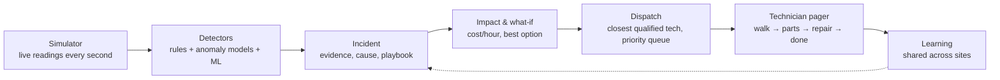

# InfraGuard AI

**From alerts to decisions.** InfraGuard AI watches every machine in a data center, predicts failures, puts a dollar value on each one, and sends the right technician in the right order.

🌐 **Live demo:** [infraguard.health](https://infraguard.health)  ·  Built at **HackUTD** by [@pranavkethireddy](https://github.com/pranavkethireddy) and [@sohaswin](https://github.com/sohaswin)

---

## The problem

Data centers produce thousands of alerts, and only a few technicians are there to answer them. Monitoring tools tell you *something* is wrong. They don't tell you:

- **What it costs:** which failure loses the most money every hour it stays down.
- **What to do:** the likely cause and the repair steps.
- **Who should go:** which qualified technician is closest, and what they should drop.

GPU downtime is expensive. Technicians lose time walking, fetching parts, and working on low-value jobs while critical failures wait.

## What InfraGuard does

| | |
|---|---|
| 🏢 **Covers the whole facility** | GPU servers down to each part (GPUs, memory, power supplies, network cards, fans, drives), plus UPS, generators, transfer switches, chillers, cooling units, power strips, network switches, smoke detection and fire suppression. That's 170 machines and 300+ assets, plus a second site, a crypto mining farm. |
| 🔍 **Detects failures two ways** | Engineering rules catch known failures. Anomaly models (one Isolation Forest per equipment family, trained on healthy behavior) catch the ones nobody wrote a rule for. |
| 💬 **Explains each incident with evidence** | It shows the likely cause and the repair playbook, retrieved from maintenance records and written up by an LLM agent. Physical work always needs human approval. |
| 💵 **Puts a price on every incident** | It shows the cost per hour while down and the savings if fixed now. It compares three options: fix now, wait for the cheap maintenance window, or buy time by shifting load. It recommends the one that saves the most. |
| 🧑‍🔧 **Dispatches technicians** | The closest qualified technician goes, counting real walking time, including the trip to the parts cabinet. Jobs auto-accept on the technician's pager. |
| 🚨 **Uses priority levels** | Levels run from 1 to 5, where 5 is the most urgent. A level only ever goes up. Fire and smoke come first. A more urgent job takes over the current one, and the old job goes back in the queue, so nothing is lost. |
| 🧠 **Learns from every repair** | Each finished repair records what failed, what fixed it, how long it took and what it cost. That knowledge is shared with every site that has the same equipment. |
| 🌪️ **Has a chaos mode** | Random failures across every kind of equipment, with priorities changing, so you can watch the crew reorganize itself live. |

## How it works



1. **Simulate:** a Python simulator streams readings for every asset at both sites.
2. **Detect:** rule detectors, per-family anomaly models and trained ML models score each reading.
3. **Open an incident:** a failure opens an incident (deduplicated). The agent retrieves matching maintenance records and writes the likely cause and the repair steps.
4. **Price it:** the impact assumptions give the downtime cost and repair cost. The what-if engine ranks the fix options.
5. **Dispatch:** the backend picks a technician, plans their walk across the floor through the parts cabinet, and keeps every technician's queue sorted by priority level.
6. **Learn:** each closed repair becomes a learned case, available to every site.

## Screens

| Page | What you see |
|---|---|
| **Overview** | Facility floor map, facility status, GPU jobs, and the incident queue |
| **Live fleet** | Both sites live: halls, racks, servers and their parts, fault injection, chaos mode |
| **Incidents** | Evidence, investigation, maintenance records, impact ledger, priority, repair playbook |
| **Operations** | Repair plan (what-if), crew on the floor map, automatic dispatch, learning matrix |
| **Technician pager** | A technician's current job, walking ETA, steps, and priority-sorted queue |
| **Assets / Models** | Equipment register, reading history, model cards and metrics |

## Tech stack

| Layer | Tech |
|---|---|
| Frontend | React 19, TypeScript, Vite, Tailwind CSS, TanStack Query, Recharts |
| Backend | Python, FastAPI, Pydantic, server-sent events for live updates |
| ML | scikit-learn (Isolation Forest, gradient boosting, logistic regression), pandas, NumPy |
| AI agent | Vultr Serverless Inference or Gemini, with a deterministic retrieval-based fallback |
| Simulation | Python simulator with seeded scenarios and chaos mode |
| Deploy | Docker, Railway, custom domain [infraguard.health](https://infraguard.health) |

## Models and measured results

Every number below comes from the training scripts in `scripts/`, measured on a held-out test split. See `ml/artifacts/model_cards/`.

| Model | Data | Task | Test results |
|---|---|---|---|
| `industrial-failure-v1` | UCI AI4I 2020 | Machine failure at time of observation | F1 0.78 · precision 0.87 · recall 0.71 · PR-AUC 0.81 · ROC-AUC 0.98 |
| `drive-failure-v1` | Backblaze drive stats 2025 Q1 | Drive fails within 30 days | ROC-AUC 0.83 · PR-AUC 0.13 (no-skill baseline 0.001) · recall 0.33 |
| Facility anomaly models | Simulated healthy readings | One Isolation Forest per equipment family | Scores in about 0.03 ms per reading |

## Run it locally

You need Python 3.11+ and Node 20+.

```bash
# Backend (from the repo root)
python3 -m venv .venv && source .venv/bin/activate
pip install -r backend/requirements.txt -r ml/requirements.txt
cp backend/.env.example backend/.env    # optional: add GEMINI_API_KEY for AI explanations
uvicorn backend.app.main:app --reload --port 8000
```

```bash
# Frontend (second terminal)
cd frontend
npm install
npm run dev
```

Open the URL Vite prints, go to **Live fleet**, start the live loop, and turn on chaos mode or inject a fault.

Without an AI key, the incident agent uses its deterministic fallback, which is built from the same maintenance records.

**Tests:**

```bash
python -m pytest backend/tests ml/tests simulator
cd frontend && npm test
```

**Docker (one server, one URL):**

```bash
docker compose up -d --build
```

## Repository layout

```
backend/     FastAPI app: API, schemas, services (detectors, incidents, impact, ops, pager, chaos, learning, agent)
frontend/    React + TypeScript dashboard
simulator/   Live fleet simulator and scenarios
ml/          Training, evaluation, model artifacts and model cards
scripts/     Data preparation and training CLIs
configs/     Layouts, detector thresholds, impact assumptions, crew and chaos settings
contracts/   Shared API JSON contract and fixtures
data/        Maintenance records and datasets
deploy/      Dockerfiles, Caddy and Railway config
```

## Hackathon tracks

| Track | How InfraGuard fits |
|---|---|
| **NMC²**: data center resilience | Live monitoring of every facility system, evaluated failure models, anomaly detection, and an end-to-end incident response |
| **CBRE**: facility operations | Downtime cost, repair-time estimates, fix-now vs. wait vs. buy-time decisions, and technician dispatch |
| **8090.AI**: agentic AI on legacy data | An agent that calls the models, retrieves past maintenance records, cites them, and recommends the fix |
| **Design** | A clear operations console: risk at a glance, a guided incident flow, and a technician pager |

## Honest limitations

- The anomaly models are trained on simulated healthy readings. AI4I and Backblaze show that the ML pipeline works; they don't prove accuracy on real data center equipment.
- Live state is kept in memory, so a restart resets the demo.
- Gemini's free tier has a daily limit. When it runs out, the deterministic fallback explanation is shown instead.

## How we built it

Two people, each with a coding agent. The agents coordinated through a pinned GitHub issue used as a message board (`tools/board`, rules in `AGENTS.md`). Each agent tagged the other when a contract changed or a handoff was ready. Each person owned their own folders, and the API contract in `contracts/` was agreed before either side built against it.

| | Owned |
|---|---|
| **Pranav Kethireddy** ([@pranavkethireddy](https://github.com/pranavkethireddy)) | Backend, AI agent, ML models, detection, impact, dispatch, deployment |
| **Sohaswin** ([@sohaswin](https://github.com/sohaswin)) | Frontend dashboard, simulator, integration |
